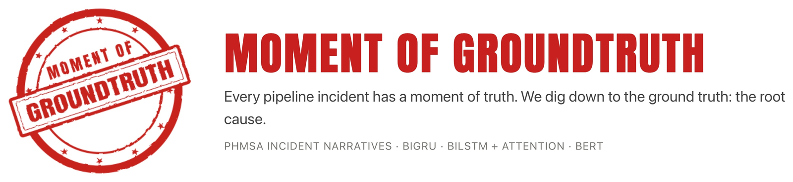
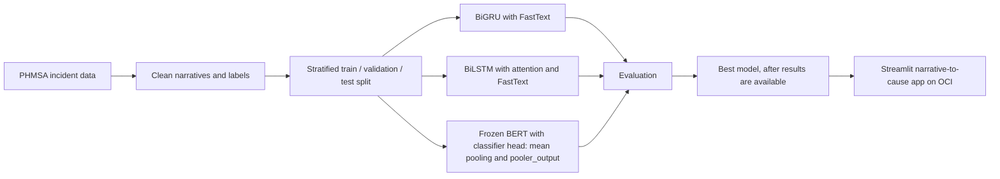
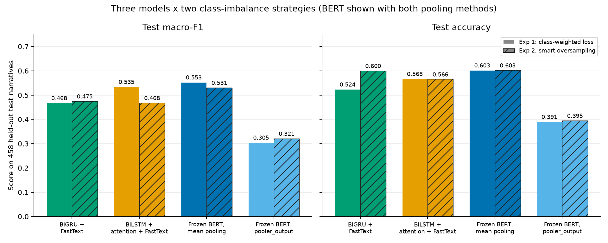
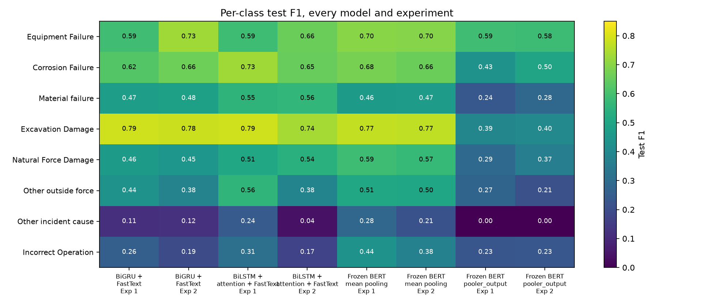

<h1 align="center">
  
</h1>

<p align="center">
  <a href="https://www.python.org/"></a>
  <a href="https://pytorch.org/"></a>
  <a href="https://streamlit.io/"></a>
  <a href="#license"></a>
</p>

## Chapter 0 — Header


**Name meaning:** “Moment of truth” is the instant something is decided, and “ground truth” is the machine learning term for the correct label. Here the correct label is the **CAUSE** of a gas pipeline incident, and pipelines are buried in the ground. The logo is a rubber stamp because every report ends the same way: someone has to stamp a cause on it.

This project reads the written account of a U.S. gas transmission or gathering pipeline incident and predicts its cause from eight categories. The work moves from public incident reports, through three text models, to a Streamlit app that returns a predicted cause, a picture of it, and a SHAP explanation when someone pastes in a narrative.

<br clear="right">

## Chapter 1 — Something underground goes wrong

Pipelines move gas across long distances, often out of sight. When a line fails, the consequences can reach people, homes, and the land above it.

The [National Transportation Safety Board (NTSB)](https://www.ntsb.gov/investigations/Pages/DCA10MP008.aspx) investigated a natural gas transmission pipeline rupture in San Bruno, California, on September 9, 2010. The NTSB recorded 8 deaths and 58 injuries (10 serious and 48 minor); 38 homes were destroyed and 70 were damaged. Its report describes a defective seam weld and a pressure increase before the rupture ([NTSB investigation](https://www.ntsb.gov/investigations/Pages/DCA10MP008.aspx), [accident report](https://www.ntsb.gov/investigations/AccidentReports/Reports/PAR1101.pdf)).

Earlier, on August 19, 2000, a natural gas pipeline ruptured near Carlsbad, New Mexico. The NTSB attributed the failure to severe internal corrosion and recorded 12 deaths, no serious or minor injuries, and reported property and other losses of $998,296 ([NTSB accident report](https://www.ntsb.gov/investigations/AccidentReports/Reports/PAR0301.pdf)).

These are two documented examples, not a measure of how often any cause occurs. The project dataset uses eight cause labels: equipment failure, corrosion failure, material failure of pipe or weld, excavation damage, natural force damage, other outside force damage, other incident cause, and incorrect operation. Later chapters show what those labels look like in the reports.

The photographs below show pipeline infrastructure and conditions, not the two incidents described above. The construction and river-crossing photographs were taken in England; they are illustrative, not U.S. incident evidence.


*Corrosion can leave a pit in the steel wall of a buried gas pipeline.*


*A pipeline trench puts heavy machinery and pipe-laying work in the same narrow strip of ground.*


*A river crossing is one place where water and ground movement matter.*


*Compressor stations contain equipment that helps move gas through a transmission system.*

## Chapter 2 — The paperwork nobody has time to read

When an operator discovers a reportable gas pipeline incident, federal rules require an incident report no later than 30 days after discovery ([49 CFR § 191.15](https://www.ecfr.gov/current/title-49/subtitle-B/chapter-I/subchapter-D/part-191/section-191.15)). The narrative is written in ordinary language. Across thousands of reports, reading every account by hand takes time.

Here is one short excerpt from the project CSV for each cause class. Operator names are omitted. The wording is kept as it appears in the source narrative, including its original capitalization and spelling.

**Equipment Failure**
> “line separated at the coupling, mp 63.988 on the north main loop line near the onward compressor station.”

**Corrosion Failure**
> “while conducting a c p survey, pipeline personnel located a gas leak.”

**Material Failure of Pipe or Weld**
> “crack propagated to critical size by fatigue due to effects of operating pressure cycles.”

**Excavation Damage**
> “landowner was using a backhoe to dig ditches and a hole for a new septic system on his property.”

**Natural Force Damage**
> “the pipe pulled apart in the bottom of a small creek crossing.”

**Other Outside Force Damage**
> “the puncture was apparently caused by a large caliber fire arm.”

**Other Incident Cause**
> “gas bubbles were visible and that no sheen was evident on the water.”

**Incorrect Operation**
> “the low pressure suction shutdown switch had been de-activated, allowing the low pressure blower to continue to run, pulling the developing explosive fuel/air mixture through the flare system.”

Each line is a small core sample: useful, but not the whole report. The model sees the narrative text, not the operator name.

## Chapter 3 — Taking a core sample

The raw PHMSA CSV contains 3,044 rows. All 3,044 narratives are usable — no records were removed. Its columns are `REPORT_NUMBER`, `IYEAR`, `NAME`, `CAUSE`, `CAUSE_DETAILS`, and `NARRATIVE`. `NARRATIVE` is the model input; `CAUSE` is the label. `NAME` is present in the source data but is not printed with the excerpts above.

The source is public [PHMSA Gas Transmission and Gathering Incident Data](https://www.phmsa.dot.gov/data-and-statistics/pipeline/pipeline-incident-20-year-trends), from the U.S. Department of Transportation’s Pipeline and Hazardous Materials Safety Administration (PHMSA). Pipeline operators submit the reports on Form PHMSA F 7100.2. The project merged the 2002–2009 historical file with the 2010–present file and mapped older cause labels into the current eight categories. All records in this raw CSV have a usable narrative.

The source narratives are mostly uppercase and include extra whitespace. Five are not entirely uppercase; cleaning lowercases all rows.

### Incidents by cause

Counts and percentages below were computed from the supplied CSV. Percentages are rounded to one decimal place.

| Cause | Narratives | Share |
|---|---:|---:|
| Equipment Failure | 787 | 25.9% |
| Corrosion Failure | 657 | 21.6% |
| Material Failure of Pipe or Weld | 372 | 12.2% |
| Excavation Damage | 362 | 11.9% |
| Natural Force Damage | 301 | 9.9% |
| Other Outside Force Damage | 210 | 6.9% |
| Other Incident Cause | 190 | 6.2% |
| Incorrect Operation | 165 | 5.4% |

*Equipment Failure is the largest group in this file. Incorrect Operation is the smallest.*

### Incidents by year


*The CSV contains one 2001 record and 88 records from 2026. The 2026 count is a partial-year snapshot, not a full-year total.*

### Narrative length


*Using whitespace-separated word counts, the median narrative has 136 words and the mean is 167.25 words.*

### The planned split

Text is cleaned by unescaping HTML entities, removing real HTML tags, fixing whitespace, and converting to lowercase. A stratified split keeps the cause proportions similar in each partition. “Stratified” means each split is sampled to preserve the class mix.

| Partition | Share | Narratives |
|---|---:|---:|
| Train | 70% | 2,130 |
| Validation | 15% | 456 |
| Test | 15% | 458 |
| Total | 100% | 3,044 |


*The files use a leakage-safe stratified split at the cleaned-narrative group level and are reproducible with seed 42.*

### Reproduce the data split

```powershell
pip install -r requirements.txt
python scripts/prepare_data.py
```

## Chapter 4 — Three drills, one dig site

The three models use the same cleaned dataset and split. All three crew members share data preparation, cleaning, historical-data merging, splitting, and final analysis.

### Parva’s speed-reader: BiGRU

A GRU is a recurrent neural network that carries a compact state as it reads tokens. A bidirectional GRU reads in both directions. Parva’s model uses pretrained FastText word embeddings: vectors learned from a large text collection before this task.

```text
Narrative tokens --> forward GRU ----\
                                      +--> combine --> cause classifier --> 8 classes
Narrative tokens --> backward GRU ---/
```

### Muhammad’s highlighter: BiLSTM with attention

An LSTM is a recurrent network with gates that help it retain or forget information. Muhammad’s bidirectional LSTM also uses attention, a mechanism that learns which token representations to emphasize. It uses pretrained FastText embeddings.

```text
Narrative tokens --> forward LSTM ---\
                                      +--> attention --> cause classifier --> 8 classes
Narrative tokens --> backward LSTM --/
```

### Sakina’s scholar: BERT

BERT is a transformer language model pretrained on text. This version uses `bert-base-uncased`; its 12 layers, 12 attention heads, and 768-number token vectors are kept frozen. Only the classification head is trained. The head maps one 768-number narrative vector to 8 cause scores, with 6,152 trainable weights. Two ways of building that single vector were run and are both reported:

| Version | Narrative vector | Results folder |
|---|---|---|
| Mean pooling (main result) | Average of all real token vectors, padding ignored | `sakina/results_mean_pooling/` |
| `pooler_output` (original PRD design) | The `[CLS]` vector passed through BERT's pooler layer | `sakina/results/` |

```text
Narrative --> BERT-base-uncased (frozen) --> token vectors (768 each)
          --> pooling (mean, or [CLS] pooler_output) --> one vector (768)
          --> trainable head (768 -> 8) --> predicted cause
```

### From incident report to app



## Chapter 5 — The moment of truth: who digs deepest?


All three models are trained and scored on the same 458 held-out test narratives, under both class-imbalance strategies from the proposal: **Exp 1** (class-weighted loss on the original training set) and **Exp 2** (smart oversampling with validated synthetic narratives, no class weights). Every number below is read from the results files the three of us committed; nothing is estimated. The full write-up, with figures, is in [`reports/final_comparison.md`](reports/final_comparison.md), and `python evaluation/compare_models.py` regenerates it.

The frozen BERT model was run with two pooling methods, so it appears twice in the summary: **mean pooling** (the average of all token vectors, the main BERT result) and **`pooler_output`** (the `[CLS]` vector through BERT's pooler layer, the original PRD design).



### Summary (test set)

| Model | Experiment | Macro precision | Macro recall | Macro F1 | Micro F1 | Accuracy |
|---|---|---:|---:|---:|---:|---:|
| BiGRU + FastText | Exp 1 | 0.4857 | 0.4618 | 0.4678 | 0.5240 | 0.5240 |
| BiGRU + FastText | Exp 2 | 0.5567 | 0.4700 | 0.4749 | 0.6004 | 0.6004 |
| BiLSTM + attention + FastText | Exp 1 | 0.5558 | 0.5428 | 0.5347 | 0.5677 | 0.5677 |
| BiLSTM + attention + FastText | Exp 2 | 0.4845 | 0.4656 | 0.4681 | 0.5655 | 0.5655 |
| Frozen BERT, mean pooling | Exp 1 | 0.5745 | 0.5484 | 0.5532 | 0.6026 | 0.6026 |
| Frozen BERT, mean pooling | Exp 2 | 0.5601 | 0.5193 | 0.5310 | 0.6026 | 0.6026 |
| Frozen BERT, pooler_output | Exp 1 | 0.3766 | 0.3010 | 0.3051 | 0.3908 | 0.3908 |
| Frozen BERT, pooler_output | Exp 2 | 0.3331 | 0.3392 | 0.3212 | 0.3952 | 0.3952 |

Micro F1 equals accuracy for single-label classification. Macro precision and recall are the unweighted mean of the eight per-class values.

### Per-class results, Exp 1 (class-weighted loss)

| Cause | BiGRU P | BiGRU R | BiGRU F1 | BiLSTM P | BiLSTM R | BiLSTM F1 | BERT (mean pooling) P | BERT (mean pooling) R | BERT (mean pooling) F1 |
|---|---:|---:|---:|---:|---:|---:|---:|---:|---:|
| Equipment Failure | 0.674 | 0.525 | 0.590 | 0.690 | 0.508 | 0.585 | 0.755 | 0.653 | 0.700 |
| Corrosion Failure | 0.567 | 0.687 | 0.621 | 0.805 | 0.667 | 0.729 | 0.667 | 0.687 | 0.677 |
| Material Failure of Pipe or Weld | 0.491 | 0.456 | 0.473 | 0.564 | 0.544 | 0.554 | 0.378 | 0.596 | 0.463 |
| Excavation Damage | 0.886 | 0.709 | 0.788 | 0.796 | 0.782 | 0.789 | 0.804 | 0.745 | 0.774 |
| Natural Force Damage | 0.457 | 0.467 | 0.462 | 0.524 | 0.489 | 0.506 | 0.733 | 0.489 | 0.587 |
| Other Outside Force Damage | 0.500 | 0.387 | 0.436 | 0.652 | 0.484 | 0.556 | 0.583 | 0.452 | 0.509 |
| Other Incident Cause | 0.095 | 0.143 | 0.114 | 0.171 | 0.429 | 0.245 | 0.276 | 0.286 | 0.281 |
| Incorrect Operation | 0.216 | 0.320 | 0.258 | 0.244 | 0.440 | 0.314 | 0.400 | 0.480 | 0.436 |

### Per-class results, Exp 2 (smart oversampling)

| Cause | BiGRU P | BiGRU R | BiGRU F1 | BiLSTM P | BiLSTM R | BiLSTM F1 | BERT (mean pooling) P | BERT (mean pooling) R | BERT (mean pooling) F1 |
|---|---:|---:|---:|---:|---:|---:|---:|---:|---:|
| Equipment Failure | 0.710 | 0.746 | 0.727 | 0.673 | 0.644 | 0.658 | 0.675 | 0.720 | 0.697 |
| Corrosion Failure | 0.545 | 0.848 | 0.664 | 0.597 | 0.717 | 0.651 | 0.619 | 0.707 | 0.660 |
| Material Failure of Pipe or Weld | 0.647 | 0.386 | 0.484 | 0.550 | 0.579 | 0.564 | 0.433 | 0.509 | 0.468 |
| Excavation Damage | 0.706 | 0.873 | 0.780 | 0.694 | 0.782 | 0.735 | 0.754 | 0.782 | 0.768 |
| Natural Force Damage | 0.475 | 0.422 | 0.447 | 0.690 | 0.444 | 0.541 | 0.639 | 0.511 | 0.568 |
| Other Outside Force Damage | 0.727 | 0.258 | 0.381 | 0.476 | 0.323 | 0.385 | 0.706 | 0.387 | 0.500 |
| Other Incident Cause | 0.143 | 0.107 | 0.122 | 0.050 | 0.036 | 0.042 | 0.263 | 0.179 | 0.213 |
| Incorrect Operation | 0.500 | 0.120 | 0.194 | 0.147 | 0.200 | 0.169 | 0.391 | 0.360 | 0.375 |

BERT columns above use mean pooling; the `pooler_output` per-class numbers are in [`reports/final_comparison.md`](reports/final_comparison.md).



### What the results show

- **Highest test macro-F1:** Frozen BERT, mean pooling / Exp 1 (0.5532). **Highest validation macro-F1:** BiGRU + FastText / Exp 2 (0.5857). The two rankings disagree, and the top three test scores are within about 0.02 of each other, so this is a close race rather than a clear winner.
- **Mean pooling vs `pooler_output`:** mean pooling raised BERT's test macro-F1 from 0.305 to 0.553 (Exp 1) and from 0.321 to 0.531 (Exp 2). With the transformer frozen, the `[CLS]` vector was never trained for this task; averaging uses every token. See [`reports/pooling_comparison.md`](reports/pooling_comparison.md).
- **Class weights vs oversampling:** neither strategy wins everywhere. Oversampling lowered macro-F1 for BiLSTM and BERT (mean pooling) and changed BiGRU's by under 0.01. The rare classes (Other Incident Cause, Incorrect Operation) stayed the weakest under both strategies.
- **Hardest causes:** Other Incident Cause and Incorrect Operation. **Easiest:** Excavation Damage and Corrosion Failure. The most common mistakes confuse Corrosion Failure with Material Failure and Equipment Failure with several other causes ([confusion matrices](reports/figures/final/04_confusion_matrices.png)).
- **Size is not the story:** the BERT head trains 6,152 weights; the BiLSTM trains 903,688. See [`reports/figures/final/06_params_vs_macro_f1.png`](reports/figures/final/06_params_vs_macro_f1.png).

Each run is one seed on a 458-row test set, with 25 to 31 test rows in each rare class, so differences of a few hundredths could change with another seed. The three models were trained with separate code and settings.

**Best model:** the proposal ranks by macro-F1. By test macro-F1 that is Frozen BERT, mean pooling / Exp 1. Treat the final pick for the Streamlit app as a team decision once the close runs are reviewed; none of the model weights are tracked in this repository.

**How to read these numbers:** Precision asks, “When the model predicts this cause, how often is it right?” Recall asks, “Of the reports with this cause, how many did it find?” F1 balances precision and recall. Macro F1 averages the class scores equally; micro F1 pools decisions across examples. Accuracy is the share of all predictions that are correct.

Class-weighted loss gives less common classes more influence during training. It is a training choice, not a substitute for reporting per-class results.

## Chapter 6 — Ground control

The deliverable is a Streamlit web app, page title **Moment-of-GroundTruth**. Paste in an incident narrative (or pick one of eight real test-set reports) and it returns:

- the predicted cause, stamped like the logo, with the model's confidence and a bar for each of the eight causes;
- an illustrative photo of what that cause looks like (credits in [docs/images/CREDITS.md](docs/images/CREDITS.md));
- a **SHAP** explanation that shades each word by how much it pushed the model toward or away from the answer.

Six tabs explain the project in plain language: **Find the cause**, **The story** (why this problem, why the name), **Data & split**, **The models**, **Results** (all the comparison graphs) and **Limits & credits**. Headings use Anton, the logo's typeface (an approximation; the logo itself is a PDF).

**Which model is in the app:** frozen BERT-base-uncased with mean pooling and a linear head, trained with Experiment 1 settings (class-weighted loss). The app retrains this small head locally from cached BERT features (`app/build_head.py`), so its test scores (57.9% accuracy, 0.522 macro-F1) are close to, but not identical to, the Colab run in Chapter 5 (0.553 macro-F1). The tracked file `app/artifacts/head.pt` holds only the 6,152-weight head; BERT itself is downloaded from Hugging Face on first run (about 440 MB).

**Speed:** the model loads once when the page opens (about 10 seconds). A prediction takes about 0.1 seconds. SHAP is the slow step (about 15 seconds quick, 40 seconds detailed) because it re-scores the narrative with words hidden; the app shows a progress bar.

**Run locally** (Python 3.10+, from the project root):

```text
pip install torch --index-url https://download.pytorch.org/whl/cpu
pip install -r requirements.txt
streamlit run app/app.py
```

Then open http://localhost:8501. To rebuild the head from scratch (needs the data splits in `data/experiment1/`): `python app/build_head.py`.

**Deploy to OCI (VM):** the repository includes a systemd unit and a setup script in `deploy/`. On an Ubuntu VM with at least 4 GB of RAM:

1. In the OCI console add an ingress rule (TCP 8501) to the VM's security list or network security group.
2. Clone the repository (URL in Chapter 7), `cd MomentOfGroundTruth`, then run `bash deploy/setup_vm.sh`. It installs dependencies, adds swap, opens the VM firewall and starts the app as a `gt-app` service.
3. Open `http://<vm-public-ip>:8501`. Put nginx and a certificate in front for HTTPS and a clean URL.

The Streamlit app has no live URL recorded here yet. It has no login, so restrict the ingress source if it should not be public. Do not commit credentials or private keys.

### The presentation website

The project deck is also a website: **https://momentofgroundtruth.netlify.app**. Netlify redeploys it on every push to `main` (config in `netlify.toml`; the page is built from `docs/Moment of GroundTruth.html` by `python web/build_web.py`). It adds three things to the deck:

- **Live demo slide.** Pick one of eight real held-out test reports and the page shows the stamped cause, the confidence for all 8 causes, the cause photo and the SHAP word shading. These are the real model's saved outputs, so the slide works with no server. The page can call the model live instead: run `bash deploy/setup_vm.sh` on a VM, point `/api` in `netlify.toml` at it and set `LIVE_API_ENABLED = True` in `web/build_web.py`.
- **Audience game, "Can you beat the model?"** A QR code opens `/play/` on phones, where people pick the cause of one real test report. The next slide shows the live votes against the model, then reveals the correct answer and the model's answer (press `V`; `Shift+X` clears the votes). Votes live in Netlify Blobs through `netlify/functions/game.mjs`. The answers stay on the server until the reveal.
- **Title-slide stamp animation** and the project stamp as the browser icon.

The audience game needs no VM; it runs on Netlify. Reveal and reset use a host key (default in `web/build_web.py`; set a `HOST_KEY` environment variable in Netlify to override it).

## Chapter 7 — Dig site map

The repository holds the shared data pipeline, all three models, and the combined evaluation. The Streamlit app is in `app/`.

```text
.
|-- README.md
|-- Group1_Project_PRD.pdf, Team1_ProjectProposal.pdf
|-- data/                    raw PHMSA CSV, cleaned data, experiment1/ and experiment2/ splits
|-- scripts/                 data preparation, synthetic data, chart generators
|-- src/, tests/             shared cleaning and split code with tests
|-- app/                     Streamlit app: app.py, tabs, SHAP, head.pt, cause photos
|-- deploy/                  OCI VM setup script and systemd unit
|-- requirements.txt         app dependencies
|-- evaluation/
|   |-- compare_models.py    builds the 3-model x 2-experiment comparison
|   |-- master_results.csv   one row per run (also .json)
|-- reports/
|   |-- final_comparison.md  full comparison with tables and figures
|   |-- pooling_comparison.md  BERT mean pooling vs pooler_output
|   `-- figures/final/       comparison figures
|-- parva/                   BiGRU + FastText code and results
|-- muhammad/                BiLSTM + attention + FastText code and results
|-- sakina/                  frozen BERT code, results/ (pooler_output), results_mean_pooling/
`-- docs/                    logo PDF; images/ holds the logo and README images
```

The GitHub repository is [`sakina-saifuddin/MomentOfGroundTruth`](https://github.com/sakina-saifuddin/MomentOfGroundTruth):

```text
git clone https://github.com/sakina-saifuddin/MomentOfGroundTruth.git
cd MomentOfGroundTruth
```

### Reproduce the model comparison

```text
python -m pip install matplotlib numpy
python evaluation/compare_models.py
```

This reads the saved results of all three models, rewrites `reports/final_comparison.md`, `evaluation/master_results.csv`, and the figures in `reports/figures/final/`. It does not retrain anything.

### Reproduce the README charts

1. Download the public gas transmission and gathering incident files from [PHMSA’s pipeline incident data page](https://www.phmsa.dot.gov/data-and-statistics/pipeline/pipeline-incident-20-year-trends). The supplied project CSV is not tracked in this repository.
2. Use Python 3 and install Matplotlib and Pillow: `python -m pip install matplotlib pillow`.
3. Run the chart generator with the path to the merged CSV:

   ```text
   python scripts/generate_readme_charts.py --csv path/to/PHMSA_Gas_Transmission_Gathering_2002_Present.csv
   ```

4. The script writes the four chart images into `docs/images/`.

Training code and results for each model are in `parva/`, `muhammad/`, and `sakina/`; each folder's README has its own run commands. Model weights are not tracked in the repository.

## Chapter 8 — Limits and next steps

- The model labels past incident narratives. It does not predict whether or when a future incident will happen.
- The classes are imbalanced: Equipment Failure makes up 25.8% of the supplied data, while Incorrect Operation makes up 5.4%. Class-weighted loss addresses this during training but does not make the dataset balanced.
- Frozen BERT trains only 6,152 weights, far fewer than full fine-tuning or the 903,688 in the BiLSTM. With mean pooling it still scored the highest test macro-F1 (Exp 1), but with `pooler_output` it scored lowest. Whether full fine-tuning would do better was not tested.
- BERT-base-uncased accepts at most 512 tokens at a time. Longer narratives need a documented truncation or chunking policy.
- Operators file the incident reports. Older cause labels were mapped to the current eight categories, so the labels reflect reporting and mapping choices.
- The raw CSV has one `IYEAR` value of 2001 and 88 of 2026. The 2001 report describes an incident on 11-7-2001 discovered on 1-21-02; both it and the partial-year 2026 records are retained.
- Every run is one seed on a 458-row test set, so small gaps between models are not reliable. Repeating runs over several seeds would show which differences hold.
- The models were trained with separate code and settings; some differences may come from training choices rather than architecture.
- The final model choice, the live OCI URL for the Streamlit app and an app screenshot remain TODOs. Only the small app head (`app/artifacts/head.pt`) is tracked; the full model checkpoints from the Colab runs are not.
- App only: narratives over about 350 words are cut at BERT's 512-token limit (about 6% of training narratives exceed it), SHAP explanations are slow, "Other outside force damage" has a sketch instead of a photo, and the pictures illustrate a cause rather than show the incident.

## Chapter 9 — Crew and credits

**Group 1**

- **Sakina Saifuddin** — frozen BERT-base-uncased classifier.
- **Muhammad Murtaza** — BiLSTM with attention and pretrained FastText embeddings.
- **Parva Shah** — BiGRU with pretrained FastText embeddings.

All three crew members share data preparation, cleaning, historical-data merging, splitting, and final analysis.

**Data credit:** Public PHMSA Gas Transmission and Gathering Incident Data, U.S. Department of Transportation, Pipeline and Hazardous Materials Safety Administration. The source narratives are public records; see the [PHMSA data page](https://www.phmsa.dot.gov/data-and-statistics/pipeline/pipeline-incident-20-year-trends).

### Image credits

See [docs/images/CREDITS.md](docs/images/CREDITS.md) for full attribution and reuse notes.

| File | Title | Author | License | Source |
|---|---|---|---|---|
| `pipeline-corrosion.jpg` | Corrosion pit on a buried natural-gas pipeline | Cafe Nervosa / Derek Mawhinney | [CC BY-SA 3.0](https://creativecommons.org/licenses/by-sa/3.0/) | [Wikimedia Commons file page](https://commons.wikimedia.org/wiki/File:Corrosion.Pit.jpg) |
| `gas-pipeline-construction.jpg` | Five excavators lowering pipeline into trench | Peter Facey | [CC BY-SA 2.0](https://creativecommons.org/licenses/by-sa/2.0/) | [Wikimedia Commons file page](https://commons.wikimedia.org/wiki/File:Five_excavators_lowering_pipeline_into_trench_-_geograph.org.uk_-_7218071.jpg) |
| `gas-pipeline-river-crossing.jpg` | Gas Pipeline Roman River | Bob1960evens | [CC BY-SA 4.0](https://creativecommons.org/licenses/by-sa/4.0/) | [Wikimedia Commons file page](https://commons.wikimedia.org/wiki/File:Gas_Pipeline_Roman_River.jpg) |
| `dilkon-compressor-station.jpg` | Dilkon Compressor Station, February 2019 | Steven Baltakatei Sandoval | [CC BY-SA 4.0](https://creativecommons.org/licenses/by-sa/4.0/) | [Wikimedia Commons file page](https://commons.wikimedia.org/wiki/File:Dilkon_Compressor_Station,_February_2019.jpg) |
| `logo-banner.png`, `logo-stamp.png`, `logo-stamp-root-cause.png` | Moment of GroundTruth logo (rubber-stamp mark and banner), cropped and resized from `docs/Moment of GroundTruth Logo.pdf` | Supplied by the project team | No separate license; repository license not specified | Uploaded to the repository as `docs/Moment of GroundTruth Logo.pdf` |
| `bedrock-hero.svg` | Earlier README header illustration, no longer used in the README | Moment-of-GroundTruth project | No separate license; repository license not specified | Created for the earlier README |
| `chart-cause-counts.png` | Cause counts | Moment-of-GroundTruth project, generated from PHMSA CSV | No separate license; repository license not specified | Generated by `scripts/generate_readme_charts.py` |
| `chart-incidents-by-year.png` | Incident counts by year | Moment-of-GroundTruth project, generated from PHMSA CSV | No separate license; repository license not specified | Generated by `scripts/generate_readme_charts.py` |
| `chart-narrative-lengths.png` | Narrative word-count distribution | Moment-of-GroundTruth project, generated from PHMSA CSV | No separate license; repository license not specified | Generated by `scripts/generate_readme_charts.py` |
| `chart-data-split.png` | Planned stratified split sizes | Moment-of-GroundTruth project, generated from PHMSA CSV | No separate license; repository license not specified | Generated by `scripts/generate_readme_charts.py` |
| `app/assets/*.jpg` | Cause photos used in the app (one per cause except Other outside force damage) | See [docs/images/CREDITS.md](docs/images/CREDITS.md) | CC BY-SA 2.0 / 3.0 / 4.0 and public domain (per file) | Wikimedia Commons |
| `app-screenshot-placeholder.svg` | App preview placeholder, not a product screenshot | Moment-of-GroundTruth project | No separate license; repository license not specified | Created for this README |

The Wikimedia photographs were resized and compressed for this repository. Their original file pages describe the depicted subjects and terms. The UK construction and river photographs are examples only, not U.S. incident records. The construction photograph includes workers at a distance; no one is identifiable.

### License

No repository license file is present. The project’s source-code license is therefore **not specified**. The four Wikimedia photographs retain their individual Creative Commons licenses and attribution requirements listed above. Choose and add a repository license before inviting reuse of the project code or original graphics.

### Removed or moved

- The original short project description is expanded into the story and model chapters above; its core topic—classifying gas pipeline incident causes with BiGRU, BiLSTM, and BERT—is retained.
- No setup, installation, usage, model-training, or deployment commands were present in the original repository README or contributor-folder READMEs. None were removed.
- The earlier header illustration (`bedrock-hero.svg`) was replaced by the project logo banner. The file is still in `docs/images/` but is no longer used.
- The three contributor-folder READMEs are unchanged.
