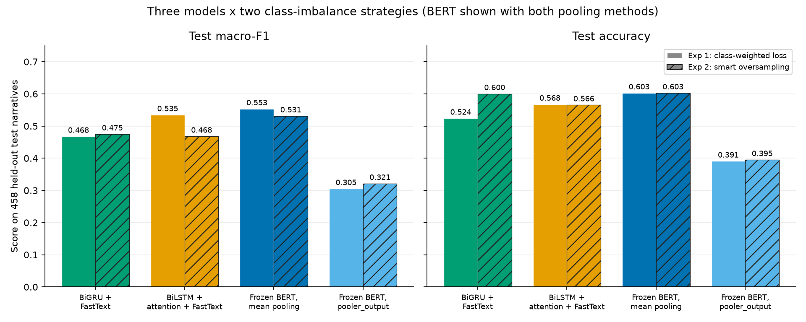
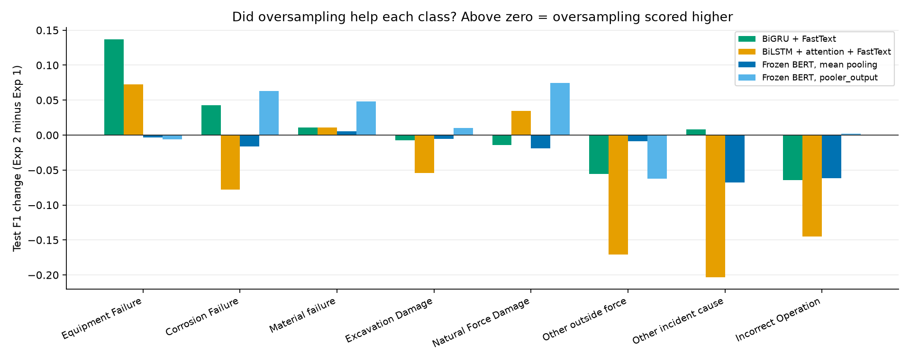
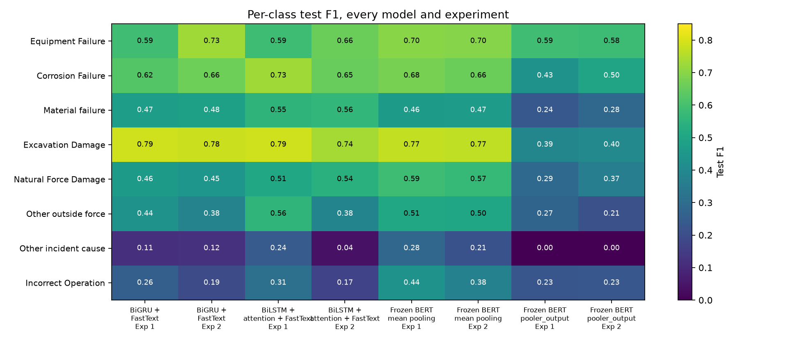
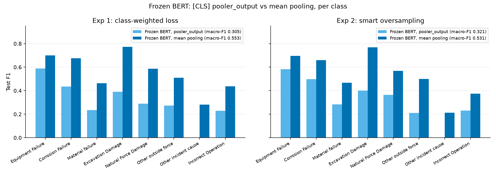
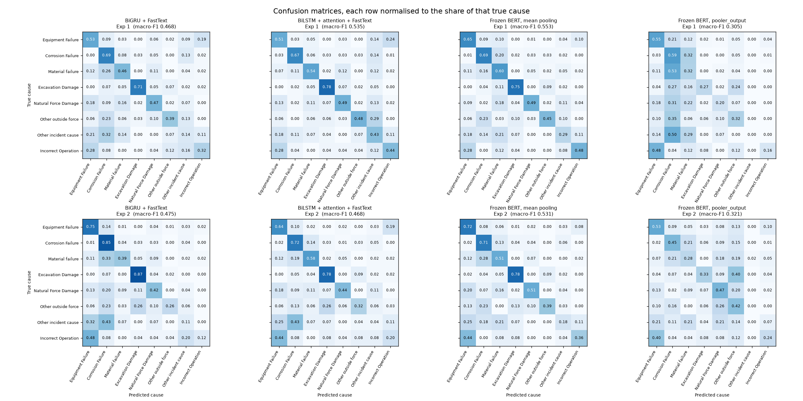
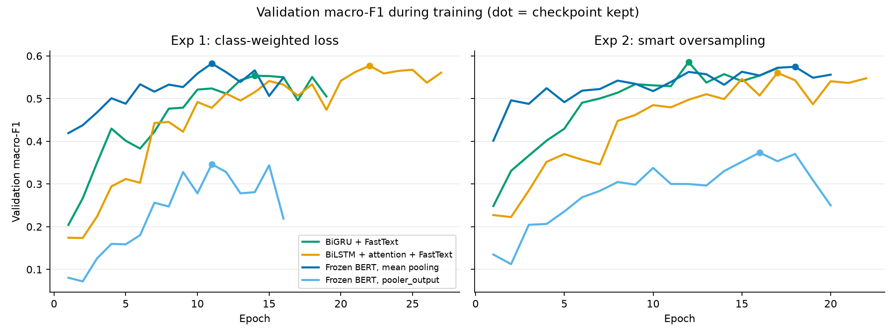
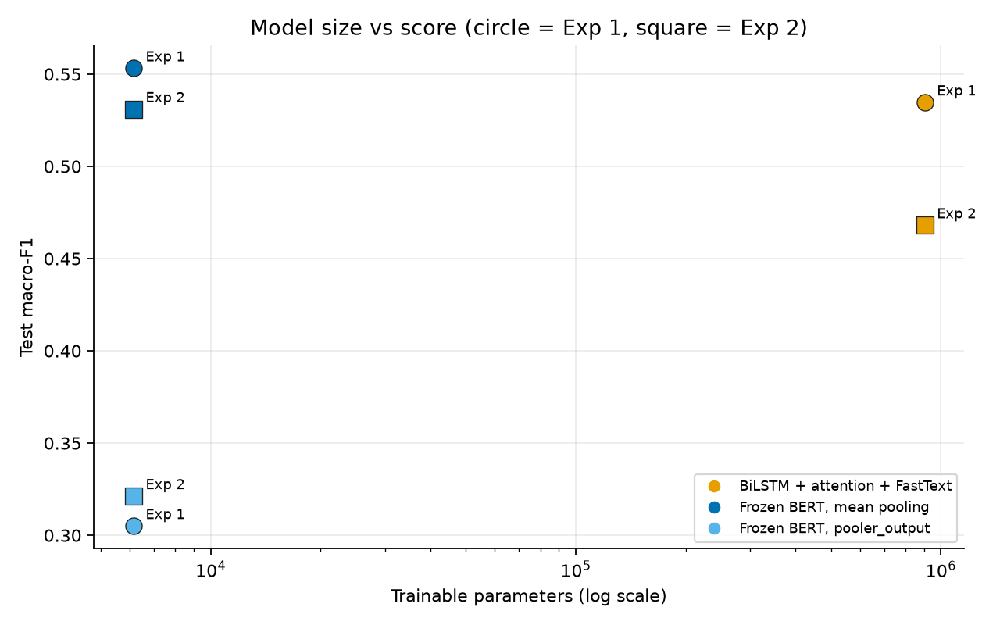

# Final comparison: 3 models x 2 experiments

Every number below is read from a saved results file (see *Sources*) and measured on the same 458 held-out
test narratives. Nothing here was retrained or estimated. Regenerate everything with
`python evaluation/compare_models.py`.

**Models.** BiGRU + FastText (Parva), BiLSTM + attention + FastText (Muhammad), frozen BERT-base-uncased with a
linear head (Sakina). Frozen BERT was run with two pooling methods, so it appears twice: **mean pooling** is the
main BERT result, and **`pooler_output`** (`[CLS]` through BERT's pooler layer, the PRD's original design) is
kept alongside it so the two can be told apart. That makes 4 model rows x 2 experiments = 8 result sets.

**Experiments.** Exp 1 trains on the original training split with class-weighted cross-entropy. Exp 2 trains on the
training split plus validated synthetic narratives with plain cross-entropy. Validation and test sets are
identical in both. (Sakina's folders call these `experiment_a` / `experiment_b`; Muhammad's do the same; Parva's
call them `exp1` / `exp2`.)

## 1. Master table (test set)

| Model | Experiment | Accuracy | Macro-P | Macro-R | Macro-F1 | Micro-F1 | Weighted F1 | Best val macro-F1 |
|---|---|---:|---:|---:|---:|---:|---:|---:|
| BiGRU + FastText | Exp 1 | 0.5240 | 0.4857 | 0.4618 | **0.4678** | 0.5240 | 0.5358 | 0.5535 |
| BiGRU + FastText | Exp 2 | 0.6004 | 0.5567 | 0.4700 | **0.4749** | 0.6004 | 0.5726 | 0.5857 |
| BiLSTM + attention + FastText | Exp 1 | 0.5677 | 0.5558 | 0.5428 | **0.5347** | 0.5677 | 0.5915 | 0.5770 |
| BiLSTM + attention + FastText | Exp 2 | 0.5655 | 0.4845 | 0.4656 | **0.4681** | 0.5655 | 0.5597 | 0.5604 |
| Frozen BERT, mean pooling | Exp 1 | 0.6026 | 0.5745 | 0.5484 | **0.5532** | 0.6026 | 0.6102 | 0.5822 |
| Frozen BERT, mean pooling | Exp 2 | 0.6026 | 0.5601 | 0.5193 | **0.5310** | 0.6026 | 0.5958 | 0.5745 |
| Frozen BERT, pooler_output | Exp 1 | 0.3908 | 0.3766 | 0.3010 | **0.3051** | 0.3908 | 0.3811 | 0.3464 |
| Frozen BERT, pooler_output | Exp 2 | 0.3952 | 0.3331 | 0.3392 | **0.3212** | 0.3952 | 0.4035 | 0.3737 |

Micro-F1 equals accuracy for single-label classification, so they match in every row. Macro-P and Macro-R are the
unweighted mean of the eight per-class values, recomputed from each file's per-class block so all models use one
definition. Weighted F1 weights each class by its test support.

### Ranking

| Rank (test macro-F1) | Run | Test macro-F1 | Test accuracy | Best val macro-F1 |
|---|---|---:|---:|---:|
| 1 | Frozen BERT, mean pooling / Exp 1 | 0.5532 | 0.6026 | 0.5822 |
| 2 | BiLSTM + attention + FastText / Exp 1 | 0.5347 | 0.5677 | 0.5770 |
| 3 | Frozen BERT, mean pooling / Exp 2 | 0.5310 | 0.6026 | 0.5745 |
| 4 | BiGRU + FastText / Exp 2 | 0.4749 | 0.6004 | 0.5857 |
| 5 | BiLSTM + attention + FastText / Exp 2 | 0.4681 | 0.5655 | 0.5604 |
| 6 | BiGRU + FastText / Exp 1 | 0.4678 | 0.5240 | 0.5535 |
| 7 | Frozen BERT, pooler_output / Exp 2 | 0.3212 | 0.3952 | 0.3737 |
| 8 | Frozen BERT, pooler_output / Exp 1 | 0.3051 | 0.3908 | 0.3464 |

- **Highest test macro-F1:** Frozen BERT, mean pooling / Exp 1 (0.5532).
- **Highest validation macro-F1:** BiGRU + FastText / Exp 2 (0.5857).

Choosing a final model on validation score and then reporting the test score avoids picking the answer that
happens to look best on the test set. When the two rankings disagree, treat the top runs as close.

## 2. Does the imbalance strategy matter? (Exp 1 vs Exp 2)

| Model | Exp 1 macro-F1 | Exp 2 macro-F1 | Change | Exp 1 accuracy | Exp 2 accuracy | Change |
|---|---:|---:|---:|---:|---:|---:|
| BiGRU + FastText | 0.4678 | 0.4749 | +0.0071 | 0.5240 | 0.6004 | +0.0764 |
| BiLSTM + attention + FastText | 0.5347 | 0.4681 | -0.0666 | 0.5677 | 0.5655 | -0.0022 |
| Frozen BERT, mean pooling | 0.5532 | 0.5310 | -0.0222 | 0.6026 | 0.6026 | +0.0000 |
| Frozen BERT, pooler_output | 0.3051 | 0.3212 | +0.0162 | 0.3908 | 0.3952 | +0.0044 |

Per-class view of the same question:

- BiGRU + FastText: Exp 2 scored higher on 4 of 8 classes (Equipment Failure, Corrosion Failure, Material failure, Other incident cause).
- BiLSTM + attention + FastText: Exp 2 scored higher on 3 of 8 classes (Equipment Failure, Material failure, Natural Force Damage).
- Frozen BERT, mean pooling: Exp 2 scored higher on 1 of 8 classes (Material failure).
- Frozen BERT, pooler_output: Exp 2 scored higher on 5 of 8 classes (Corrosion Failure, Material failure, Excavation Damage, Natural Force Damage, Incorrect Operation).

## 3. Per-class results

Test F1 by cause (E1 = Exp 1, E2 = Exp 2):

| Cause | BiGRU E1 | BiGRU E2 | BiLSTM+attn E1 | BiLSTM+attn E2 | BERT, mean pooling E1 | BERT, mean pooling E2 | BERT, pooler_output E1 | BERT, pooler_output E2 |
|---|---:|---:|---:|---:|---:|---:|---:|---:|
| Equipment Failure | 0.590 | 0.727 | 0.585 | 0.658 | 0.700 | 0.697 | 0.588 | 0.582 |
| Corrosion Failure | 0.621 | 0.664 | 0.729 | 0.651 | 0.677 | 0.660 | 0.434 | 0.497 |
| Material failure | 0.473 | 0.484 | 0.554 | 0.564 | 0.463 | 0.468 | 0.235 | 0.283 |
| Excavation Damage | 0.788 | 0.780 | 0.789 | 0.735 | 0.774 | 0.768 | 0.390 | 0.400 |
| Natural Force Damage | 0.462 | 0.447 | 0.506 | 0.541 | 0.587 | 0.568 | 0.290 | 0.365 |
| Other outside force | 0.436 | 0.381 | 0.556 | 0.385 | 0.509 | 0.500 | 0.274 | 0.211 |
| Other incident cause | 0.114 | 0.122 | 0.245 | 0.042 | 0.281 | 0.213 | 0.000 | 0.000 |
| Incorrect Operation | 0.258 | 0.194 | 0.314 | 0.169 | 0.436 | 0.375 | 0.229 | 0.231 |

Hardest causes on average across the six main runs: Other incident cause (0.17), Incorrect Operation (0.29), Other outside force (0.46). Easiest: Excavation Damage (0.77), Corrosion Failure (0.67).

Full precision / recall / F1 per class, Exp 1

| Cause | BiGRU P | BiGRU R | BiGRU F1 | BiLSTM P | BiLSTM R | BiLSTM F1 | BERT mean P | BERT mean R | BERT mean F1 | BERT pooler P | BERT pooler R | BERT pooler F1 |
|---|---:|---:|---:|---:|---:|---:|---:|---:|---:|---:|---:|---:|
| Equipment Failure | 0.674 | 0.525 | 0.590 | 0.690 | 0.508 | 0.585 | 0.755 | 0.653 | 0.700 | 0.631 | 0.551 | 0.588 |
| Corrosion Failure | 0.567 | 0.687 | 0.621 | 0.805 | 0.667 | 0.729 | 0.667 | 0.687 | 0.677 | 0.345 | 0.586 | 0.434 |
| Material failure | 0.491 | 0.456 | 0.473 | 0.564 | 0.544 | 0.554 | 0.378 | 0.596 | 0.463 | 0.188 | 0.316 | 0.235 |
| Excavation Damage | 0.886 | 0.709 | 0.788 | 0.796 | 0.782 | 0.789 | 0.804 | 0.745 | 0.774 | 0.682 | 0.273 | 0.390 |
| Natural Force Damage | 0.457 | 0.467 | 0.462 | 0.524 | 0.489 | 0.506 | 0.733 | 0.489 | 0.587 | 0.529 | 0.200 | 0.290 |
| Other outside force | 0.500 | 0.387 | 0.436 | 0.652 | 0.484 | 0.556 | 0.583 | 0.452 | 0.509 | 0.238 | 0.323 | 0.274 |
| Other incident cause | 0.095 | 0.143 | 0.114 | 0.171 | 0.429 | 0.245 | 0.276 | 0.286 | 0.281 | 0.000 | 0.000 | 0.000 |
| Incorrect Operation | 0.216 | 0.320 | 0.258 | 0.244 | 0.440 | 0.314 | 0.400 | 0.480 | 0.436 | 0.400 | 0.160 | 0.229 |

Full precision / recall / F1 per class, Exp 2

| Cause | BiGRU P | BiGRU R | BiGRU F1 | BiLSTM P | BiLSTM R | BiLSTM F1 | BERT mean P | BERT mean R | BERT mean F1 | BERT pooler P | BERT pooler R | BERT pooler F1 |
|---|---:|---:|---:|---:|---:|---:|---:|---:|---:|---:|---:|---:|
| Equipment Failure | 0.710 | 0.746 | 0.727 | 0.673 | 0.644 | 0.658 | 0.675 | 0.720 | 0.697 | 0.653 | 0.525 | 0.582 |
| Corrosion Failure | 0.545 | 0.848 | 0.664 | 0.597 | 0.717 | 0.651 | 0.619 | 0.707 | 0.660 | 0.549 | 0.455 | 0.497 |
| Material failure | 0.647 | 0.386 | 0.484 | 0.550 | 0.579 | 0.564 | 0.433 | 0.509 | 0.468 | 0.286 | 0.281 | 0.283 |
| Excavation Damage | 0.706 | 0.873 | 0.780 | 0.694 | 0.782 | 0.735 | 0.754 | 0.782 | 0.768 | 0.514 | 0.327 | 0.400 |
| Natural Force Damage | 0.475 | 0.422 | 0.447 | 0.690 | 0.444 | 0.541 | 0.639 | 0.511 | 0.568 | 0.300 | 0.467 | 0.365 |
| Other outside force | 0.727 | 0.258 | 0.381 | 0.476 | 0.323 | 0.385 | 0.706 | 0.387 | 0.500 | 0.141 | 0.419 | 0.211 |
| Other incident cause | 0.143 | 0.107 | 0.122 | 0.050 | 0.036 | 0.042 | 0.263 | 0.179 | 0.213 | 0.000 | 0.000 | 0.000 |
| Incorrect Operation | 0.500 | 0.120 | 0.194 | 0.147 | 0.200 | 0.169 | 0.391 | 0.360 | 0.375 | 0.222 | 0.240 | 0.231 |

## 4. Frozen BERT: mean pooling vs `pooler_output`

Same frozen `bert-base-uncased`, same 768 -> 8 linear head (6,152 trainable parameters), same data and
hyperparameters. Only the step that turns token vectors into one narrative vector differs.

- **`pooler_output`:** the `[CLS]` vector passed through BERT's pooler layer. One token carries the whole summary.
- **Mean pooling:** the average of every real token vector (padding ignored). Every token contributes.

| Experiment | pooler acc | mean acc | Change | pooler macro-F1 | mean macro-F1 | Change |
|---|---:|---:|---:|---:|---:|---:|
| Exp 1 | 0.3908 | 0.6026 | +0.2118 | 0.3051 | 0.5532 | +0.2481 |
| Exp 2 | 0.3952 | 0.6026 | +0.2074 | 0.3212 | 0.5310 | +0.2098 |

With the transformer frozen, `[CLS]` and its pooler were never trained for this task, so a single token is a weak
summary of a narrative whose median length is 136 words. Averaging keeps information from the whole text. This is a measured difference,
not a tested explanation; confirming the reason would need repeated runs with different seeds.

## 5. Error analysis

Most frequent mistakes for the highest test macro-F1 run (Frozen BERT, mean pooling / Exp 1):

- Corrosion Failure predicted as Material failure: 20 narratives (20% of that cause)
- Equipment Failure predicted as Material failure: 12 narratives (10% of that cause)
- Equipment Failure predicted as Incorrect Operation: 12 narratives (10% of that cause)
- Equipment Failure predicted as Corrosion Failure: 11 narratives (9% of that cause)

## 6. Training behaviour and model size

Trainable parameters: BiGRU not recorded in its results file, BiLSTM + attention 903,688, frozen BERT 6,152. BiGRU's results file records hyperparameters but not a parameter count, so it is left out of the size plot.

## 7. Caveats

- Each run is a single seed (42) on a 458-row test set. Differences of a few hundredths in macro-F1 are within what
  a different seed or split could change; the rare classes (25-31 test rows each) move the macro average a lot.
- The models were trained with separate code and settings, so differences mix architecture with training
  choices.
- Exp 2 depends on the synthetic narratives being faithful to their label. A review sample is in
  `reports/synthetic_review_sample.md`; the results are only as good as that review.
- The FastText models and BERT see different tokenisation and sequence lengths (300 word tokens vs up to 512
  WordPiece tokens).

## Sources

- BiGRU + FastText, Exp 1: `parva/bigru/bigru_exp1_results.json`
- BiGRU + FastText, Exp 2: `parva/bigru/bigru_exp2_results.json`
- BiLSTM + attention + FastText, Exp 1: `muhammad/results/experiment_a/metrics.json`
- BiLSTM + attention + FastText, Exp 2: `muhammad/results/experiment_b/metrics.json`
- Frozen BERT, mean pooling, Exp 1: `sakina/results_mean_pooling/experiment_a/metrics.json`
- Frozen BERT, mean pooling, Exp 2: `sakina/results_mean_pooling/experiment_b/metrics.json`
- Frozen BERT, pooler_output, Exp 1: `sakina/results/experiment_a/metrics.json`
- Frozen BERT, pooler_output, Exp 2: `sakina/results/experiment_b/metrics.json`

Machine-readable copy of the master table: `evaluation/master_results.csv` and `evaluation/master_results.json`.
